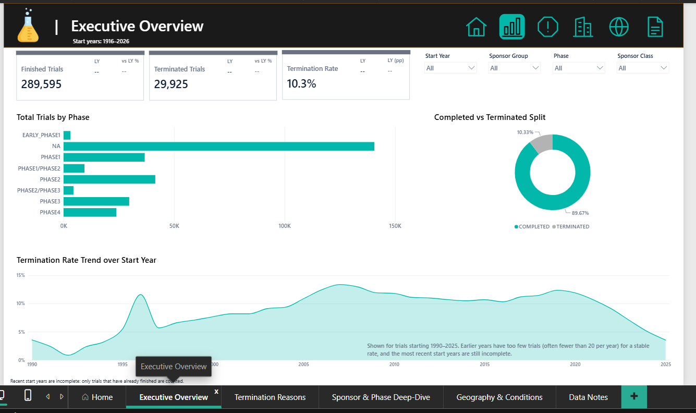
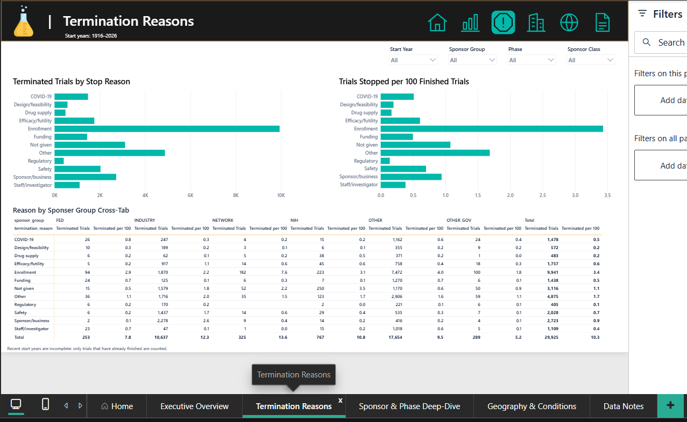
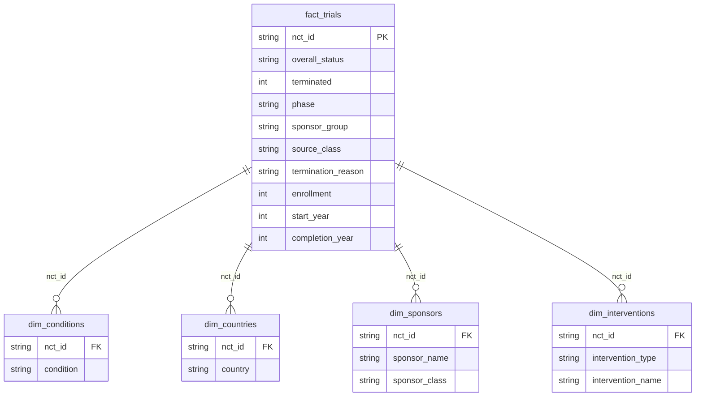

# TrialScope — Clinical Trial Termination Analysis

An end-to-end data analysis and interactive Power BI portfolio dashboard examining **289,595** finished interventional clinical trials from [ClinicalTrials.gov](https://clinicaltrials.gov), curated through the **AACT** database (CTTI).

---

## 📌 Executive Summary

- **Scale & Outcome:** Across 289,595 finished interventional studies, **10.3% (29,925 trials)** were terminated early.
- **Phase Risk:** Developmental phase is strongly associated with early stopping. When adjusting for sponsor, start year, and trial arms, **Phase 1/2 (OR 1.85, 95% CI 1.73–1.98)** and **Phase 2 (OR 1.52, 95% CI 1.45–1.60)** exhibit the highest termination odds relative to Phase 3. Trials without a defined phase (e.g. behavioral/device) show the lowest odds (OR 0.51).
- **Sponsor Influence:** After adjusting for phase, year, and study arms, industry sponsorship is **not** significantly associated with higher termination risk (OR 1.02, 95% CI 0.99–1.05).
- **Reported Stop Reasons:** While overall termination odds align across sponsors, stated rationale diverges markedly:
  - **Industry:** Business decisions, strategic portfolio prioritization, and safety signals.
  - **Other / Academic:** Insufficient patient enrollment and funding withdrawal.
- **Study Scale:** Median trial enrollment sits at **50 participants** (mean 458 is heavily skewed by 164 mega-trials enrolling >100,000 participants).

---

## 📊 Interactive Power BI Dashboard (`TrialScope`)

The project includes a production-grade **Power BI Project (`.pbip`)** adhering to the modern PBIR format, featuring a custom dark `#111111` header, `#E89522` portfolio accent, and white modular visual cards.

### Dashboard Pages & Previews

#### 1. Home — Clinical Trials at a Glance
Portfolio orientation, headline KPIs, methodology context, and modular section navigation.


#### 2. Executive Overview
Portfolio scale, phase breakdown, completion vs. termination donut split, and historical termination rate trends (1990–2025).



#### 3. Termination Reasons
Deep taxonomy of early stopping drivers: stop-reason frequencies, phase composition, and stopped trials per 100 finished studies.



#### 4. Sponsor & Phase Deep-Dive
Outcome patterns and study scale across sponsor classes (Industry, NIH, Other) and clinical phases with median enrollment comparisons.


#### 5. Geography & Conditions
Global trial distribution across 200+ countries, top terminated conditions, and an intervention performance matrix.


#### 6. Data Notes & Methodology
Technical reference for healthy volunteer categorization, COVID-19 term consolidation, and multi-intervention counting rules.


---

## 🛠️ Data Model & Semantic Architecture

The semantic model (`dashboard.SemanticModel`) is organized in a **star schema**:



### Core DAX Measures

```DAX
Total Trials = DISTINCTCOUNT ( fact_trials[nct_id] )

Terminated Trials = 
CALCULATE (
    [Total Trials],
    KEEPFILTERS ( fact_trials[overall_status] = "TERMINATED" )
)

Finished Trials = 
CALCULATE (
    [Total Trials],
    KEEPFILTERS ( fact_trials[overall_status] IN { "COMPLETED", "TERMINATED" } )
)

Termination Rate = 
DIVIDE ( [Terminated Trials], [Total Trials] )

Terminated per 100 Finished Trials = 
100 * DIVIDE ( [Terminated Trials], [Finished Trials] )

Median Enrollment = 
MEDIAN ( fact_trials[enrollment] )

Has Sufficient Start Year Volume = 
IF ( [Total Trials] >= 20, 1, 0 )
```

---

## 🔬 Methodology & Statistical Modeling

1. **Cohort Selection:** Filtered 606,820 AACT records to interventional trials with finalized outcomes (`COMPLETED` or `TERMINATED`).
2. **Text Classification:** Applied ordered, regex-based keyword classification on free-text `why_stopped` annotations across 10 categories (Enrollment, Efficacy/Futility, Safety, Sponsor/Business, Funding, COVID-19, Regulatory, Drug Supply, Design/Feasibility, Staff/Investigator).
3. **Logistic Regression:** Modeled termination probability using `smf.logit`:
   $$\text{logit}(P(\text{Terminated})) = \beta_0 + \beta_{\text{phase}} + \beta_{\text{sponsor}} + \beta_{\text{year}} + \beta_{\text{arms}}$$
   Adjusting for baseline factors confirms Phase 1/2 and Phase 2 carry the highest termination odds, while the raw gap between Industry and Other dissipates.

---

## 📂 Repository Structure

```text
├── clinical_trial_termination_analysis.ipynb   # Full exploratory analysis & logistic regression
├── prepare_powerbi_data.py                    # ETL pipeline transforming AACT raw files into star-schema CSVs
├── dashboard.pbip                             # Power BI Project entry point
├── dashboard.Report/                          # Power BI Report PBIR definition & visuals
├── dashboard.SemanticModel/                   # Power BI TMDL semantic model & DAX measures
├── screenshots/                               # High-resolution dashboard page previews
├── images/                                    # Workflow diagrams & regression rate plots
├── powerbi_guide.md                           # Comprehensive dashboard build guide
├── requirements.txt                           # Python dependencies
└── .gitignore                                 # Git ignore rules for data, cache, and notes
```

---

## 🚀 How to Run Locally

### 1. Python Environment & Analysis
```bash
# Clone the repository
git clone https://github.com/PrashantDes/clinical_trial_termination_analysis.git
cd clinical_trial_termination_analysis

# Install dependencies
pip install -r requirements.txt

# Run the Jupyter Notebook
jupyter notebook clinical_trial_termination_analysis.ipynb
```

### 2. Generate Power BI Data & Open Dashboard
```bash
# Download AACT monthly pipe-delimited flat files into data/ (or set AACT_DIR)
# Run the data preparation script:
python prepare_powerbi_data.py

# Open the dashboard in Power BI Desktop
start dashboard.pbip
```

---

## 📜 Data Attribution & License

- **Data Source:** [ClinicalTrials.gov](https://clinicaltrials.gov) via the [AACT Database](https://aact.ctti-clinicaltrials.org/) curated by the Clinical Trials Transformation Initiative (CTTI).
- **License:** Released under the [MIT License](LICENSE).
