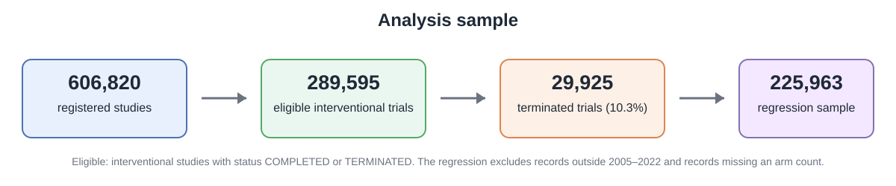
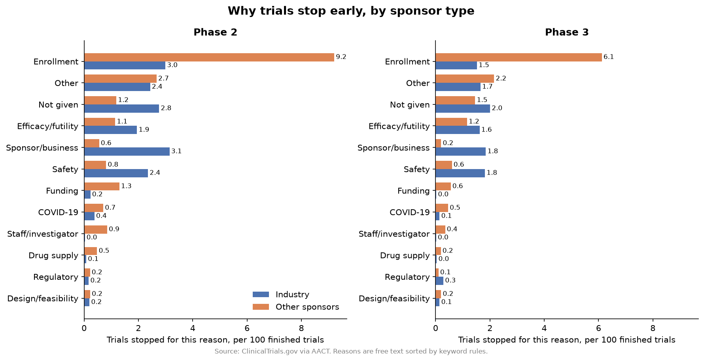

# Why Do Clinical Trials Stop Early?

An analysis of 289,595 completed or terminated interventional trials from [ClinicalTrials.gov](https://clinicaltrials.gov), using the AACT database.

**Question:** Why do some clinical trials stop early, and does it depend on trial phase or on who sponsors the trial?

## What I did

1. Loaded the AACT `studies` table (606,820 registered studies) and kept finished interventional trials (completed or terminated).
2. Cleaned the free-text `why_stopped` column by sorting reasons into categories with keyword rules, then checked samples by eye.
3. Compared stop reasons by phase and by sponsor type, first as shares of terminated trials, then as rates per 100 finished trials.
4. Fitted a logistic regression to see which factors matter when considered together.

## Key results

- About 10% of finished trials were terminated.
- With sponsor group, start year, and number of arms held constant, Phase 1/2 (OR 1.85) and Phase 2 (OR 1.52) have the highest odds of early termination versus Phase 3. Trials with no recorded phase have the lowest odds (OR 0.51).
- Industry is not clearly different from the `OTHER` sponsor group after adjustment (OR 1.02, 95% CI 0.99 to 1.05).
- The reasons recorded at termination differ by sponsor group: business and safety labels are more common for industry trials, while enrollment and funding labels are more common for `OTHER`.
- The model has a low pseudo R-squared (0.03), so the findings describe broad patterns rather than predict the outcome of an individual trial.

## Analysis flow

## Visual preview

The chart below compares the reported termination reasons by sponsor type for Phase 2 and Phase 3 trials. Rates are shown per 100 finished trials.

## Limitations

Stated reasons are not proven causes. The keyword rules assign one label to each trial and can make mistakes: in four 25-record hand checks, the Safety rule was correct for only 8 records because it also matched phrases such as "no safety concerns." The data are observational, and disease area and trial size are not controlled for. Full details are in the notebook.

## How to run

1. Install the requirements: `pip install -r requirements.txt`.
2. To use the included snapshot, set `AACT_DIR` to `data`. To use a new AACT download, put the files in `data/aact/` or set `AACT_DIR` to that folder.
3. Open `clinical_trial_termination_analysis.ipynb` and choose **Kernel > Restart & Run All**.

## Files

- `clinical_trial_termination_analysis.ipynb`: the full analysis
- `images/analysis_flow.svg`: study-selection and regression-sample overview
- `images/stop_reasons_per_100_trials.png`: reason-specific termination rates by sponsor group and phase
- `requirements.txt`: Python packages

Data: ClinicalTrials.gov via AACT (CTTI). Use is subject to the ClinicalTrials.gov terms and conditions.
